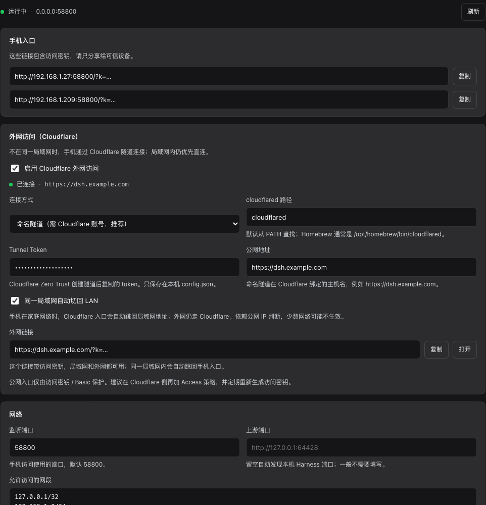

# dsh-phone-remote

[中文](README.md) · [Install](#install) · [Configuration](#configuration) · [Security](#security-model-read-this) · [Troubleshooting](#troubleshooting)

> [!IMPORTANT]
> **This plugin only works with the DeepSeek Harness desktop client.**
>
> dsh-phone-remote is a **DeepSeek Harness plugin (Host + settings-page Client)**. It runs inside the DeepSeek Harness client process and mirrors that client's local Web UI onto your LAN. It is **not** a generic reverse proxy or a standalone website; the optional Cloudflare tunnel only exposes this client's own Web UI to your own devices. It **does not work** with Claude Code, Cursor, Codex, VS Code, ChatGPT, or any other AI client. Without DeepSeek Harness, this plugin does nothing.

Turn a phone or tablet into a second screen for DeepSeek Harness: one link on the same LAN, or from outside through an optional Cloudflare named tunnel (account and domain required). No app to install.



> The access key is redacted in this screenshot.

> Open **Plugins → Installed plugins → Phone Remote**. Change settings, then click **Save and apply**; the gateway restarts automatically.

```
┌─────────────┐    LAN HTTP / WebSocket     ┌──────────────────────────────────┐
│  Phone      │ ──────────────────────────▶ │  dsh-phone-remote (58800)        │
│  Browser    │ ◀────────────────────────── │  ├─ access key / Basic auth      │
└─────────────┘                             │  ├─ CIDR allowlist                │
                                            │  └─ session-cookie minting       │
                                            └──────────────┬───────────────────┘
                                                           │ 127.0.0.1
                                            ┌──────────────▼───────────────────┐
                                            │ DeepSeek Harness desktop client  │
                                            │ Web UI (webServer) + Agent       │
                                            └──────────────────────────────────┘
```

> Unofficial community plugin. Not affiliated with DeepSeek.

---

## Scope (read first)

| Item | Supported |
| --- | --- |
| DeepSeek Harness desktop client (macOS, tested with `0.2.1-rc.3`) | ✅ |
| Other DeepSeek Harness versions | ⚠️ Should work; may need adaptation if host APIs or cookie format change |
| Phone / tablet browser on the same LAN | ✅ |
| Phone / tablet away from home (cellular, other network) | ✅ Via the optional Cloudflare tunnel; requires `cloudflared` |
| Claude Code / Cursor / Codex / VS Code / ChatGPT / other AI clients | ❌ Not applicable |
| Generic reverse proxy, static server, or tunnel | ❌ Not a design goal |
| Directly exposing the gateway port to the internet | ❌ Use the Cloudflare tunnel; do not port-forward |

It depends on two DeepSeek Harness host services:

- `webServer` — to discover the real local Web UI origin;
- `credentials` (optional) — to read the `client-connection/browser-session` record and mint a browser session cookie for the phone.

Without them the plugin cannot work, which is why it is **DeepSeek Harness only**.

---

## Features

- **One link in**: `http://<lan-ip>:58800/?k=<access-key>`; the first visit sets a 1-year gateway cookie, then the bare origin works.
- **Full Web UI proxy**: HTTP, streaming/SSE, and WebSocket (`/api/remote.mux`) are forwarded; sessions, tool calls, and approval prompts behave like the desktop UI.
- **Access protection**: `?k=` auto-login, gateway cookie, or optional HTTP Basic.
- **LAN allowlist**: loopback plus configured IPv4 CIDRs; defaults are derived from local interfaces.
- **Automatic Harness session minting**: signs a 30-day browser session cookie in-process, retries once with a fresh credential on upstream 401.
- **Remote access (optional, Cloudflare)**: when the phone is away or on cellular, connect through a `cloudflared` **named tunnel** (token + stable hostname). ⚠️ Quick tunnels do not support SSE, so the Harness UI cannot load; use them only for connectivity tests. LAN is still preferred on the home network, and the Cloudflare entry 302-redirects phones that share the computer's public IP back to the LAN link.
- **In-app settings page**: edit the listen port, upstream port, CIDR allowlist, Basic credentials, access key, mobile enhancement, and the Cloudflare tunnel right on the plugin page; saving rewrites `config.json` and restarts the gateway.
- **Follows the plugin switch**: disabling the plugin in DeepSeek Harness closes the listener and the tunnel immediately; enabling it brings them back.
- **Mobile drawer enhancement**: on narrow screens the built-in sidebar becomes a slide-out drawer with a hamburger button, and iOS input zoom is avoided.
- **Zero third-party dependencies on LAN**: Node.js standard library only; remote mode additionally needs the official `cloudflared` binary (not bundled).
- **Built-in diagnostics**: dashboard, `/__dshgw/status`, logs, `phone-url.txt`, and a CLI.

---

## How it works

1. The plugin starts as a host bundle and creates its own HTTP server on `0.0.0.0:58800`; it also registers one loopback-only config endpoint, `/phone-remote/api/config`, on the Harness `webServer` for the settings page.
2. The upstream origin comes from `ctx.webServer.getOrigin()`; if that fails it falls back to `ps` + `lsof` discovery of the Harness Web UI port, cached for 8 seconds.
3. Each request is checked against the source CIDR allowlist, then authenticated by access key or Basic.
4. It reads the local `~/.dsh/.credentials.yaml` record `client-connection/browser-session`, mints a Harness browser-session cookie with HMAC-SHA256, and forwards the request.
5. For HTML documents it injects the mobile drawer CSS/JS before `</body>`; everything else is passed through.
6. WebSocket upgrades are authenticated and piped both ways.
7. When Cloudflare is enabled the plugin supervises a `cloudflared` child process: quick tunnels are discovered from the `trycloudflare.com` URL in its output, named tunnels connect with `TUNNEL_TOKEN`; URL changes are written back to `phone-url.txt` and the status payload. Quick tunnels do not support SSE, so they cannot load the full UI.
8. Requests arriving through Cloudflare carry `CF-Connecting-IP`; the gateway compares it with the computer's detected public IP. If `autoLanRedirect` is on and they match (the phone is on the home network), it 302-redirects to the LAN link; otherwise it proxies through Cloudflare.
9. The settings page (`client.js`) mounts through the `plugins.bundle.config` slot, calls the same-origin config API, and saving rebuilds the gateway and tunnel instances.

Apart from that loopback-only config endpoint, the plugin never registers routes on the Harness web server, never edits Harness configuration, and never logs credential values.

---

## Requirements

- **DeepSeek Harness desktop client** (the only supported host), with its Web UI running.
- Phone and computer on the **same LAN** (same Wi-Fi or the same router), **or** `cloudflared` installed for remote mode.
- Remote mode needs the official `cloudflared` (`brew install cloudflared` on macOS; see the [Cloudflare docs](https://developers.cloudflare.com/cloudflare-one/connections/connect-networks/downloads/) for other platforms) and outbound access to Cloudflare.
- Port `58800` free (configurable).
- Node.js ≥ 20 for the standalone scripts; the plugin itself uses the client's bundled runtime.
- Tested on macOS. Linux/Windows desktop builds should work but are untested.

---

## Install

### Option A: from DeepSeek Harness settings (recommended)

1. Clone the repository:

   ```bash
   git clone https://github.com/FlameTinary/dsh-phone-remote.git ~/CodeRepo/dsh-phone-remote
   ```

2. In DeepSeek Harness, open the sidebar **Plugins** page (Settings → Plugins) and click **Add plugin**.
3. Enter the **absolute local path** to this directory, e.g. `/Users/sheldon/CodeRepo/dsh-phone-remote`, then click **Install**.
4. Under **Installed plugins**, find **Phone Remote** and make sure its switch is on.

> Upgrading from 0.1.x: the package name is now `@flametinary/dsh-phone-remote`. Uninstall the old plugin and install again; configuration, keys, and logs stay in `~/.dsh/phone-remote/`.

> Installation links the checkout. After `git pull`, restart DeepSeek Harness to load the new JS; no reinstall is needed.

### Option B: plugin manager (automation / remote support)

From a DeepSeek Harness agent session:

```json
{ "action": "install_bundle", "target": "/Users/sheldon/CodeRepo/dsh-phone-remote" }
```

`list_bundles` should then show:

```text
@flametinary/dsh-phone-remote  0.3.0  availability=profile  installed=true  enabled=true
```

Enable or disable with:

```json
{ "action": "set_bundle", "target": "@flametinary/dsh-phone-remote", "enabled": false }
```

### What happens on first start

- Creates `~/.dsh/phone-remote/config.json` (`0600`) with a random access key and Basic password.
- If a legacy skill / launchd gateway config exists at `~/.dsh/remote-gateway/config.json`, it is **migrated automatically** (port, keys, CIDRs, and other settings).
- Starts the listener and writes `~/.dsh/phone-remote/phone-url.txt` (`0600`) with phone URLs and Basic credentials.

> ⚠️ The legacy skill ran a launchd gateway that occupies port `58800`. Stop it before enabling this plugin:
>
> ```bash
> launchctl bootout gui/"$UID"/com.dsh.remote-gateway 2>/dev/null || true
> mv ~/Library/LaunchAgents/com.dsh.remote-gateway.plist \
>    ~/Library/LaunchAgents/com.dsh.remote-gateway.plist.disabled 2>/dev/null || true
> ```

---

## Usage

### Get the phone link

Any of:

- open **`http://127.0.0.1:58800/__dshgw/`** on the computer (Basic or access key required);
- read `~/.dsh/phone-remote/phone-url.txt`;
- run:

  ```bash
  node /path/to/dsh-phone-remote/bin/phone-remote.mjs url
  ```

Example:

```text
Phone URLs (same LAN, contains the access key):
  http://192.168.1.42:58800/?k=xxxxxxxxxxxxxxxxxxxxxxxxxxxxxxxx
Basic auth: dsh / xxxxxxxxxxxxxxxxxx
```

### Open it on the phone

Connect the phone to the same Wi-Fi and open the link. The first visit redirects to `/` (303) and sets a gateway cookie; afterwards `http://192.168.1.42:58800/` works directly.

Bookmark the redirected URL. The `?k=` value only appears in the first URL.

### Check status

```bash
node /path/to/dsh-phone-remote/bin/phone-remote.mjs status
```

Returns JSON with `ok`, `version`, `pid`, `uptimeSeconds`, `upstream`, `listen`, `allowCidrs`, `phoneUrls`, `remoteUrls`, `cloudflare`, `configPath`.

### Enable / disable in settings

DeepSeek Harness → Plugins → Installed plugins → **Phone Remote**:

- off: the listener closes immediately and the phone can no longer connect;
- on: the listener comes back with the same URL and keys.

### Configure in the app

Open **Plugins → Installed plugins → Phone Remote**. The plugin page renders the configuration panel directly:

- **Phone entry points** — every current LAN URL, with copy buttons;
- **Network** — listen port, upstream port, IPv4 CIDR allowlist, mobile drawer enhancement;
- **Access credentials** — Basic username/password and the access key (show, copy, regenerate);
- **Save and apply** — writes `~/.dsh/phone-remote/config.json` and restarts the gateway; no manual toggle needed.

The config endpoint lives on the Harness `webServer` and accepts only loopback connections. It requires a JSON request with the `x-phone-remote-config: 1` header, so cross-site requests fail the browser preflight.

### Away from the LAN: Cloudflare

> ⚠️ **Cloudflare Quick Tunnels do not support SSE** ([Cloudflare docs](https://developers.cloudflare.com/tunnel/get-started/quick-tunnels/)). The Harness UI uses SSE to load its plugin graph, so a quick tunnel leaves it stuck at “Loading plugins…”. **Use a named tunnel** (Cloudflare account + a domain on Cloudflare) for real remote use.

1. Install `cloudflared` on the computer:

   ```bash
   brew install cloudflared
   ```

   Linux/Windows: see the [Cloudflare downloads page](https://developers.cloudflare.com/cloudflare-one/connections/connect-networks/downloads/).

2. In [Cloudflare Zero Trust](https://one.dash.cloudflare.com/) create a **named tunnel** and add a Public Hostname:
   - Hostname: `dsh.example.com` (your domain)
   - Service: `http://127.0.0.1:58800`
   Copy the tunnel token.
3. Open **Plugins → Installed plugins → Phone Remote → Remote access (Cloudflare)** and tick **Enable Cloudflare remote access**.
4. Choose **Named tunnel**, paste the token and your public URL (for example `https://dsh.example.com`), then click **Save and apply** and wait for **Connected**.
5. Copy the public link (it contains `?k=`) from **Public link**, or press **Open**; turn off Wi-Fi on the phone and open it over cellular.

**Quick tunnel** (no account) remains selectable for connectivity tests, but it cannot load the full Harness UI, and its URL changes on every restart.

**Back to LAN automatically**: with `autoLanRedirect` on, a phone on the home network hits the Cloudflare URL, the gateway compares `CF-Connecting-IP` with the computer's public IP, and redirects to the LAN link when they match. This is a heuristic: CGNAT, multiple egresses, or proxied networks can defeat it; the Cloudflare URL still works when it does.

> For a named tunnel, add a **Cloudflare Access** policy (email/SSO) as well. The plugin's access key and Basic auth stack on top of it.

---

## Configuration

Use the **plugin settings page** for normal changes. The file is `~/.dsh/phone-remote/config.json` (created on first start, mode `0600`); advanced users can still edit it by hand.

```json
{
  "listenHost": "0.0.0.0",
  "listenPort": 58800,
  "allowCidrs": ["127.0.0.1/32", "192.168.1.0/24"],
  "accessKey": "…",
  "basicUser": "dsh",
  "basicPass": "…",
  "upstreamPort": null,
  "uiEnhance": { "mobileDrawer": true },
  "logMaxBytes": 1048576,
  "cloudflare": {
    "enabled": false,
    "mode": "token",
    "token": "",
    "publicUrl": "",
    "autoLanRedirect": true,
    "cloudflaredPath": "cloudflared"
  }
}
```

| Field | Default | Description |
| --- | --- | --- |
| `listenHost` | `0.0.0.0` | Bind address. Loopback makes the phone unreachable. |
| `listenPort` | `58800` | Gateway port. On conflict the plugin retries every 5 s instead of crashing. |
| `allowCidrs` | loopback + each NIC's `/24` | Allowed IPv4 CIDRs. **Must include the phone's subnet**, otherwise 403. |
| `accessKey` | random 32 chars | Access key (≥ 16 chars). Used by `?k=`, the `dsh-gw` cookie, and the dashboard. |
| `basicUser` / `basicPass` | `dsh` / random | Optional HTTP Basic credentials (password ≥ 8 chars). |
| `upstreamPort` | `null` | Pin the Harness UI port. Leave `null` for automatic discovery. |
| `uiEnhance.mobileDrawer` | `true` | Inject the mobile drawer enhancement. |
| `logMaxBytes` | `1048576` | Log rotation threshold; rotates to `gateway.log.1`. |
| `cloudflare.enabled` | `false` | Start the Cloudflare tunnel. When off, `cloudflared` is never spawned. |
| `cloudflare.mode` | `"token"` | `token` for a named tunnel (account required; full app); `quick` is a temporary URL that Cloudflare cannot stream SSE through. |
| `cloudflare.token` | `""` | Tunnel token for named mode; stored only in the local `config.json` (`0600`). |
| `cloudflare.publicUrl` | `""` | Hostname bound to the named tunnel, e.g. `https://dsh.example.com`. Ignored in quick mode. |
| `cloudflare.autoLanRedirect` | `true` | Redirect phones that share the computer's public IP from the Cloudflare entry back to the LAN link. |
| `cloudflare.cloudflaredPath` | `"cloudflared"` | Path to the `cloudflared` binary; Homebrew normally puts it on `PATH`. |

Saving on the settings page restarts the gateway automatically. After editing the JSON by hand, toggle the plugin off/on (or restart the client).

### Rotate the access key

Click **Regenerate** under Access credentials on the settings page. Old links and cookies stop working immediately; copy the new phone link.

You can also edit `config.json`: delete `accessKey` / `basicPass` (new random values are generated on start), then toggle the plugin off/on.

---

## Security model (read this)

The plugin exposes **full control of the DeepSeek Harness client** to any authenticated device.

- **The access key is full access.** Anyone with the link or Basic password can read sessions, send messages, trigger tool calls, and approve permission requests. Protect it like an SSH key.
- **LAN by default.** The default allowlist is loopback plus the current `/24`. For remote access use the built-in Cloudflare tunnel — do not set `allowCidrs` to `0.0.0.0/0` and do not port-forward on your router. The tunnel reuses the same access-key / Basic checks; it does not bypass them.
- **The public entry widens the attack surface.** Once Cloudflare is enabled, anyone on the internet can reach the login page; the access key / Basic auth is the boundary. Add a Cloudflare Access policy (email, Google, GitHub, SSO) as well, and never post links containing `?k=` publicly or commit them.
- **Public-IP detection is a heuristic.** `autoLanRedirect` only redirects when the phone and computer share a public IP; CGNAT, multiple egresses, proxies, or cloud networks can defeat it. When it fails the Cloudflare entry still works, just without the LAN shortcut.
- **No TLS on LAN.** LAN links use plain HTTP/WS and can be sniffed on the same Wi-Fi. In Cloudflare mode TLS terminates at Cloudflare, and Cloudflare-to-computer is loopback HTTP. Avoid untrusted networks.
- **The Tunnel token is as sensitive as the machine's network access.** Anyone with it can run this tunnel elsewhere. Keep it in the settings page / local `config.json`; rotate it in the Cloudflare dashboard if leaked.
- **Cookies last 30 days** and are re-minted per request; they may break after credential rotation or a client upgrade — reopen the `?k=` link.
- **The settings page is sensitive too.** Anyone who can open it can change ports, networks, and the access key. The config endpoint accepts only **loopback** connections and requires a JSON request with `x-phone-remote-config: 1` (cross-site preflight is not approved); the phone reaches it through the gateway, which is loopback upstream. Even so, only open it on trusted devices.
- **The config contains plaintext secrets and the tunnel token** (mode `0600`); `phone-url.txt` also contains the access key and Basic password. Never commit or share them.
- **Logs exclude cookie values** but include paths, source IPs, and errors; review before sharing.
- **Unofficial plugin**: it does not modify client binaries, but it runs with your user privileges inside the client process. Install only from trusted sources and re-check compatibility after DSH upgrades.

If you only use DeepSeek Harness on this computer, leave the plugin disabled.

---

## Mobile enhancement

Only active at viewport width ≤ 768 px:

- injects a hamburger button at the start of the Harness title row (no extra row);
- first triggers the built-in "open sidebar" action, then adds `dsh-drawer-open` on the next frame;
- closes via the overlay or the built-in "collapse sidebar" button;
- raises editable control font size to ≥ 16 px to avoid iOS Safari focus zoom;
- re-adds the button after re-renders with `MutationObserver` + `requestAnimationFrame`.

Set `uiEnhance.mobileDrawer` to `false` to disable; proxying and auth are unaffected.

---

## CLI

Requires Node.js ≥ 20 (or call `bin/phone-remote.mjs` directly).

```bash
dsh-phone-remote url       # LAN + configured Cloudflare URLs, Basic credentials, listen address, config path
dsh-phone-remote status    # query /__dshgw/status (includes cloudflare.publicUrl)
dsh-phone-remote config    # print the config path
dsh-phone-remote help
```

`url` works even when the plugin is not running (it may create the config on first use).

---

## Troubleshooting

| Symptom | Cause / fix |
| --- | --- |
| **401 login page** on the phone | Missing/rotated `?k=`. Copy the full link again from `phone-url.txt` or the dashboard; or use Basic. |
| **403 source address not allowed** | Phone subnet missing from `allowCidrs`. Add it (e.g. `192.168.1.0/24`) and restart the plugin. |
| **502 Bad Gateway** | Harness UI unreachable. Make sure the desktop client is running; optionally pin `upstreamPort`. |
| Port **58800 in use / `EADDRINUSE`** | Usually the legacy launchd gateway. Run the `launchctl bootout` command above, or change `listenPort`. |
| Plugin **missing from settings** | Install the directory that contains `package.json` and `cordis.patch.yml`, then restart the client; check `~/.dsh/profiles/<profile>/.plugin-manager/logs/`. |
| Enabled but **nothing listening** | Check `~/.dsh/phone-remote/gateway.log`; common causes are port conflicts or invalid JSON config. |
| Page loads but **keeps disconnecting** | A network device may be blocking WebSocket, or AP isolation is on. |
| **Login breaks after a client upgrade** | Cookie format may have changed. Update the plugin; temporarily reopen the `?k=` link. |
| **iOS zooms on input focus** | Confirm `uiEnhance.mobileDrawer` is `true`. |
| Phone URL shows **127.0.0.1** | `listenHost` is loopback, or no non-loopback IPv4 exists. Set `0.0.0.0`. |
| Public link shows **1033 / tunnel not found** | `cloudflared` is missing or the path is wrong, or the named tunnel is not running. Run `cloudflared --version`, point `cloudflaredPath` at the absolute path, and check `~/.dsh/phone-remote/cloudflare.log`. |
| Quick-tunnel URL **changes on every restart** | Expected for `trycloudflare.com`. Use a named tunnel (token + Public Hostname) for a stable URL. |
| Stuck at **“Loading plugins…”** through Cloudflare | Quick Tunnels do not support SSE, which the Harness UI needs to load its plugin graph. Use a named tunnel. |
| Named tunnel returns **502** | The Cloudflare Public Hostname must point at `http://127.0.0.1:58800` (or your configured port), and the plugin must be listening there. |
| Phone on the home network still uses Cloudflare | `autoLanRedirect` relies on public-IP detection; CGNAT/multi-egress can defeat it. Use the LAN link, or disable the option and switch manually. |
| All requests **403 source address not allowed** with the tunnel on | Tunnel requests arrive from `127.0.0.1`; do not remove `127.0.0.1/32` from `allowCidrs`. |

Logs: `~/.dsh/phone-remote/gateway.log` and `cloudflare.log` (each rotates at 1 MB).

---

## Upgrade, uninstall, migration

### Upgrade

```bash
cd /path/to/dsh-phone-remote
git pull
```

Then **uninstall and reinstall the plugin** from DeepSeek Harness → Plugins to load the new Host / Client JS; configuration, keys, and the tunnel token stay in `~/.dsh/phone-remote/`. Toggling the plugin off/on usually does not refresh client JS, especially after changing `client.js`.

### Uninstall

1. Settings → Plugins → Installed plugins → Phone Remote → disable;
2. remove it on the same page (or `plugin_manager` `remove_bundle`);
3. optionally delete `~/.dsh/phone-remote/`.

### Migrating from the legacy skill / launchd gateway

```bash
launchctl bootout gui/"$UID"/com.dsh.remote-gateway 2>/dev/null || true
mv ~/Library/LaunchAgents/com.dsh.remote-gateway.plist \
   ~/Library/LaunchAgents/com.dsh.remote-gateway.plist.disabled 2>/dev/null || true
```

Keep `~/.dsh/remote-gateway/config.json` so the new plugin can inherit its keys and port on first start; delete the old directory afterwards if you like.

---

## Development and verification

```bash
cd /path/to/dsh-phone-remote

# 1. Run the gateway standalone on 58801 (avoids the installed plugin on 58800)
PHONE_REMOTE_PORT=58801 node scripts/dev-server.mjs

# 2. In another terminal, run the end-to-end smoke test
PHONE_REMOTE_PORT=58801 node scripts/verify.mjs
```

`scripts/verify.mjs` covers 9 checks: unauthenticated 401, status endpoint, `?k=` 303, dashboard, drawer CSS, proxied Harness page, drawer asset injection, `/api` passthrough (404 fence instead of 401), and WebSocket upgrade (101).

Layout:

```text
index.js              # host entry: apply / inject / config API / ctx.effect
client.js             # settings page (plugins.bundle.config slot)
cordis.patch.yml      # bundle patch (row id: phone-remote)
locale/{zh,en}.json   # plugin card title and description
icon.svg              # settings icon
lib/                  # config (load/migrate/validate/update), auth, session, upstream, gateway, log, ui
ui/                   # mobile-drawer.css / mobile-drawer.js
bin/phone-remote.mjs  # url / status / config
scripts/              # dev-server.mjs / verify.mjs
docs/settings-page.png # settings page screenshot
```

---

## Known limitations

- **DeepSeek Harness only**; no other clients or generic web apps.
- IPv4 CIDRs only; IPv6 peers are rejected.
- **No TLS on LAN**; Cloudflare mode terminates TLS at Cloudflare. The plugin does not manage certificates.
- **Remote mode depends on `cloudflared`** (not bundled). Quick tunnels do not support SSE (the full UI cannot load) and their URL changes on every restart; a stable URL and the full app need a named tunnel.
- **`autoLanRedirect` is a public-IP heuristic**: CGNAT, multiple egresses, or proxies can defeat it; traffic then stays on Cloudflare rather than using the LAN shortcut.
- The mobile enhancement depends on the Harness DOM structure (`titleRow`, `aria-label="打开侧边栏"`, …) and may need adaptation after major client UI changes.
- Session cookie signing depends on the client implementation; a DSH upgrade may require a plugin update.
- On port conflict the plugin retries but does not auto-pick another port.
- The settings page needs both halves (Host + Client): after editing `client.js`, uninstall and reinstall the plugin to pick it up. A Host-only install will not show the page.

---

## License

[MIT](LICENSE) © 2026 Sheldon

Unofficial community project, not affiliated with DeepSeek. Read the [security model](#security-model-read-this) before use.
